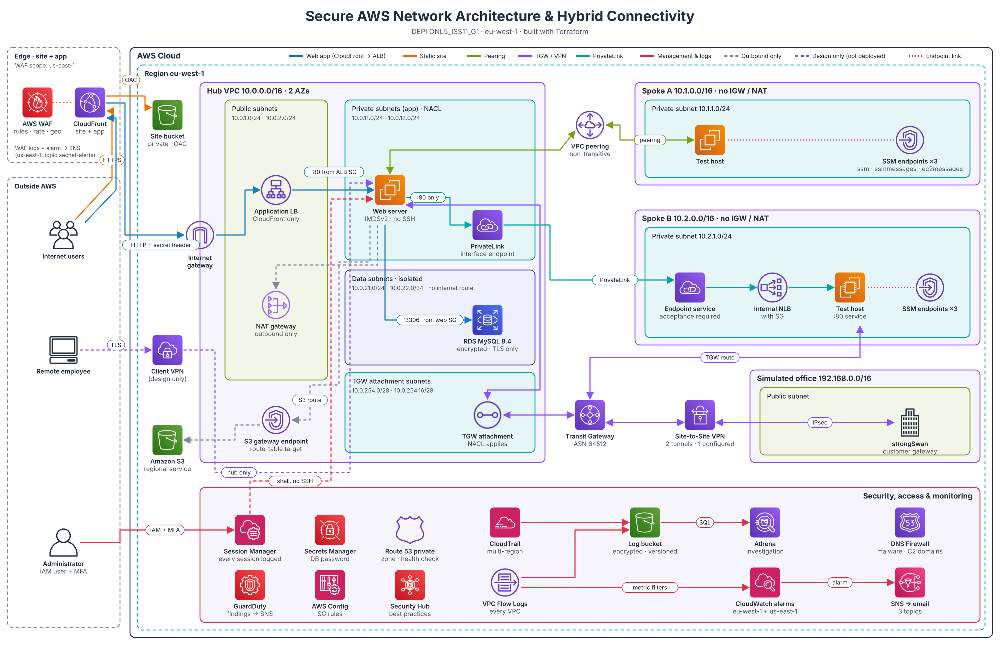
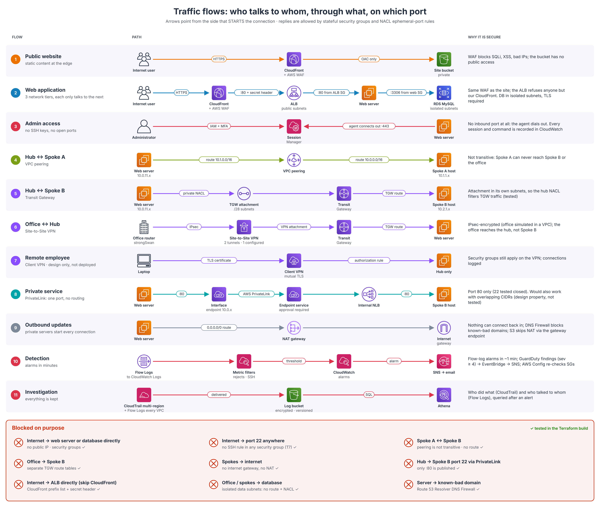

# Secure AWS Network Architecture & Hybrid Connectivity – Final report

**DEPI – Digital Egypt Pioneers Initiative** · AWS Security track · Group **ONL5_ISS11_G1** · Project 2
Region eu-west-1 (Ireland) · Infrastructure as code: Terraform · Repository: `alberayman/aws-secure-network`

---

## 1. Executive summary

We designed and built a company network on AWS in which every connection is deliberate, every layer can
stop an attacker on its own, and every action is recorded. The environment is built entirely with Terraform
and can be switched off and rebuilt from code (`make sleep`, one plan to wake it).

**What we built**

- A **hub VPC** with three network tiers across two Availability Zones: public (load balancer), private app
  (web server) and isolated data (MySQL), each tier reachable only from the tier in front of it.
- **Hybrid connectivity**: two spoke VPCs (VPC peering and Transit Gateway), a simulated office connected over
  a **Site-to-Site IPsec VPN**, a **PrivateLink** service, and VPC endpoints so private servers need no internet.
- An **edge layer**: CloudFront and AWS WAF in front of both a static website and the web application, with the
  load balancer reachable from CloudFront only.
- **Detection and response**: CloudTrail, VPC Flow Logs, CloudWatch alarms, GuardDuty, AWS Config, Security Hub,
  DNS Firewall, recorded admin sessions, Athena investigations and an incident-response runbook.

**What we proved**

- **35 automated tests** run against the live environment and all pass (latest full regression 2026-11-22).
- **Incident IR-001** (simulated compromised server) was detected by alarms in about **1 minute** and by
  GuardDuty in about **3 minutes**; it was investigated with Athena, evidence was preserved, the server was
  contained with the website still up, every action was found in CloudTrail, and the server was rebuilt from code.
- An AWS Config rule found a real misconfiguration outside the project (the default VPC's default security
  group); it was fixed in code and Config confirmed the fix two minutes later.

**What it cost**: see section 9. The full stack costs about $0.50 per hour while running and about
$0.02–0.05 per hour while sleeping; it was only switched on during working sessions.

---

## 2. Final architecture

| Layer | What it contains | Why |
|---|---|---|
| Edge | CloudFront (site + app), AWS WAF (managed rules, rate limit, geo-block), Shield Standard | Filter attacks before they reach the VPC; one WAF for both entry points |
| Hub – public tier | Application Load Balancer, NAT gateway | Only the ALB faces CloudFront; NAT gives private servers outbound-only access |
| Hub – private app tier | Web server (no public IP, IMDSv2, no SSH), PrivateLink endpoint | The application runs where nothing on the internet can reach it |
| Hub – isolated data tier | RDS MySQL 8.4 (encrypted, TLS required) | Local route only, own NACL: only the app tier can reach port 3306 |
| Connectivity | VPC peering (Spoke A), Transit Gateway with three route tables (Spoke B, office), Site-to-Site VPN, PrivateLink | Compare connection patterns; segmentation decides who can reach whom |
| Security & monitoring | CloudTrail, Flow Logs, CloudWatch, GuardDuty, Config, Security Hub, DNS Firewall, Session Manager logging, Athena, SNS | Detect quickly, investigate with evidence, alert the team |

Network plan: [cidr-plan.md](architecture/cidr-plan.md) · route tables: [route-tables.md](architecture/route-tables.md).

---

## 3. Week 1 – Secure VPC foundation

**Goal:** a hub VPC where nothing important has a public IP and every tier only accepts traffic from the
tier in front of it. Built first in the console (labs 1.1–1.4), then in Terraform (`modules/vpc`, `modules/compute`,
`modules/monitoring`).

| Built | Security point |
|---|---|
| Hub VPC 10.0.0.0/16, public + private subnets in 2 AZs, one NAT gateway | Private servers can start outbound connections; nothing can connect in |
| ALB → web EC2 → RDS MySQL, security groups chained by **group reference**, not IP | "Only the web server can reach the DB" stays true when IPs change |
| Private-subnet NACL (stateless second layer) | A mistaken security group is not the only line of defence |
| Default security group emptied (CIS 5.4) | Anything launched without a group gets no access |
| EC2: no public IP, IMDSv2 only, encrypted EBS, **no SSH**: admin access via Session Manager | No keys to steal, no port 22 anywhere |
| RDS: private, encrypted, password generated by AWS in Secrets Manager | No database password in code or state |
| CloudTrail (all Regions) + VPC Flow Logs to an encrypted, versioned S3 bucket; Athena workgroup | Every API call and network flow is kept for investigation |
| Monthly budget with email alerts (credits excluded) | Cost guardrail |
| CI on every push: `terraform fmt`, `validate`, TFLint | Broken code does not reach `main` |

**Tests (automated, `make demo ARGS="--week 1"`):** website reachable (T1), database has no public path (T2),
web server has no public IP (T3), shell without SSH (T4), web → RDS allowed (T5), no security group open to SSH
or all traffic from the internet (T7), default SG empty (T8), NACL on the private subnets (T9), CloudTrail logging
(T10), budget in place (T13). A drift drill (T6) removed the RDS rule by hand, Terraform detected it in the plan and
restored it.

**Problems worth noting:** a NACL that was created but not associated protected nothing (fixed by associating it
to both private subnets); user data with leading spaces silently failed; the budget showed $0 because credits were
netted out (fixed with `include_credit = false`). Details: [week1/README.md](week1/README.md).

## 4. Week 2 – Connectivity and hybrid networking

**Goal:** connect other networks without giving everything a path to everything.

| Built | Security point |
|---|---|
| **Spoke A** (10.1.0.0/16) over **VPC peering** | Peering is not transitive: Spoke A can never use the hub to reach Spoke B (tested) |
| **Spoke B** (10.2.0.0/16) over **Transit Gateway** | Central routing with segmentation |
| **TGW route tables** hub / spokes / on-prem instead of the default table (D5) | The office reaches the hub but has **no route** to Spoke B, even though Spoke B's SG would allow it |
| **Dedicated /28 TGW attachment subnets** (D1) | AWS does not apply NACLs to TGW traffic in the attachment's own subnet; separate subnets make the private NACL filter TGW traffic |
| **Site-to-Site VPN** (IPsec) from a simulated office VPC (strongSwan router) to the TGW | Encrypted hybrid link; router SG accepts IKE/NAT-T/ESP **only from the two AWS tunnel IPs** (D6) |
| Router setup automated (`make vpn-setup`): own IAM role, tunnel key in **Parameter Store (SecureString)** | The key is never typed, logged or committed |
| **PrivateLink**: internal NLB + endpoint service in Spoke B, interface endpoint in the hub, acceptance required (D4) | Publishes **one service on one port** without any routing between the networks |
| **VPC endpoints**: SSM, SSM messages, EC2 messages, CloudWatch Logs in both spokes; S3 gateway endpoint in the hub | Spokes have no internet at all and are still managed; S3 traffic skips the NAT |

**Tests (automated, `--week 2`):** hub ↔ Spoke A over peering (T14), hub ↔ Spoke B over TGW (T15), peering is
not transitive (T16), office → hub over IPsec with the tunnel UP (T17), office → Spoke B blocked (T18), spokes
have no internet (T19), SSM resolves to a private endpoint IP inside Spoke B (T20), PrivateLink port 80 open and
port 22 closed (T21), flow logs active on every VPC (T26).

**Problems worth noting:** an NLB cannot get a security group after creation (created with one); the PrivateLink
acceptance raced the endpoint creation (fixed with a 120-second wait, proven on rebuild); a NACL drill showed that
TGW traffic in the attachment's own subnet bypasses the NACL, which led to D1. Details:
[week2/README.md](week2/README.md), [week2/terraform-design.md](week2/terraform-design.md).

## 5. Week 3 – Edge security, WAF and DDoS

**Goal:** filter attacks at the edge and make sure nobody can go around the edge.

| Built | Security point |
|---|---|
| **Project website** in a private S3 bucket behind CloudFront with **Origin Access Control** | The bucket cannot be opened directly (403); only our distribution can read it |
| **AWS WAF** (CloudFront scope): AWS managed Common, Known Bad Inputs, SQL injection and IP reputation rules; **rate limit** 100 requests / 5 min per IP; **geo-block** list | Blocks injection, XSS, known-bad sources and floods before they reach the origin |
| **CloudFront in front of the ALB** (D8, AWS-recommended pattern) | One WAF protects both the site and the app; Shield Standard at the edge |
| ALB security group allows only the AWS-managed **CloudFront origin-facing prefix list**; listener returns **403** unless a secret header is present | The prefix list alone would admit other customers' distributions; the header proves the request came from ours |
| WAF logging to CloudWatch Logs, blocked-requests alarm → SNS (us-east-1) | Attacks are visible and alert the team |
| Route 53 private zone (`db.secnet.internal`) and an end-to-end HTTPS health check (CloudFront → WAF → ALB → web) | Internal names never leak; the whole public path is monitored |

**Tests (automated, `--week 3`):** S3 direct → 403 (T27), site over HTTPS → 200 (T28), SQL injection → 403 (T29),
XSS → 403 (T30), rate limit: 109 of 300 requests blocked (T31), ALB direct → no answer (T1b), SQL injection against
the app → 403 (T29b), private DNS + health check (T34). **Drills:** geo-blocking our own country returned 403 and
CloudWatch showed the geo rule (not the rate rule) did it; reverting returned 200 (T32). The flood also fired the
WAF alarm email (T33).

### DDoS mitigation plan

| Layer | Control in place | Production addition |
|---|---|---|
| Network / transport (L3/L4) | AWS Shield Standard on CloudFront (automatic); origin not directly reachable (prefix list + secret header) | Shield Advanced (cost protection, DDoS response team) for business-critical apps |
| Application (L7) | WAF rate-based rule, managed rule groups, geo-block | WAF Bot Control; rate rules per URI; challenge/CAPTCHA actions |
| Absorption | CloudFront edge locations cache static content (site) | Cache more of the app; origin shield |
| Detection | WAF blocked-requests alarm, WAF logs, Route 53 health check | Shield Advanced metrics and proactive engagement |
| Response | Runbook: raise rate limit / add geo or IP set block via Terraform plan + review | Pre-approved emergency change for WAF rules |

Details: [week3/README.md](week3/README.md) (design decision D8, options A/B/C).

## 6. Week 4 – Detection and incident response

**Goal:** know within minutes when something goes wrong, prove what happened, and contain it without taking the
service down. A defence-in-depth review on 2026-11-21 added seven layers (D9–D15) before the incident drill.

| # | Layer | Built |
|---|---|---|
| D9 | Data tier | Isolated data subnets: local route only, own NACL (3306 from the app subnets only); RDS re-created there |
| D10 | Threat detection | GuardDuty (CloudTrail, VPC flow and DNS analysis; paid add-ons off) |
| D11 | Compliance | AWS Config (security groups) + rules *default SG closed* and *no SSH from the internet* |
| D12 | Egress | Route 53 Resolver DNS Firewall on hub and spokes: own blocklist + AWS managed malware and botnet lists (BLOCK) |
| D13 | Visibility / alerting | Security Hub (AWS Foundational Security Best Practices); GuardDuty findings ≥ medium → EventBridge → SNS email |
| D14 | Audit | Session Manager logs every admin session and command to CloudWatch |
| D15 | Data in transit | S3 buckets deny non-TLS; MySQL requires TLS; IAM Access Analyzer |

**Tests (automated, `--week 4`):** DB in isolated subnets with no internet route (T42), office cannot reach the
DB (T43), web → DB still works (T5), GuardDuty enabled (T44), DNS Firewall blocks the test domain and allows a
normal one (T45), Config rules compliant (T46), Security Hub standard and Access Analyzer active (T47), session
logging configured (T48), TLS enforced (T49). **Drills:** GuardDuty low-severity sample stayed on the dashboard
while a high-severity sample was emailed (T50); an admin session's commands were found in CloudWatch (T51).

### Config finding: detect → fix → verify

The *default SG closed* rule flagged the default security group of the account's default VPC (outside the
project), which still had AWS's built-in rules. We brought it under Terraform with no rules; Config re-evaluated
and reported COMPLIANT two minutes later. Production recommendation: delete the default VPC.

### Incident report – IR-001: compromised web-tier server (rehearsal, 2026-11-21)

| Item | Detail |
|---|---|
| Scenario | A server in the hub app tier (same security group and role as the web server) behaves like a compromised host: `make ir-simulate` |
| Attack (T0 20:12 UTC) | Port scan of a Spoke A host (80 ports), 10 SSH attempts, DNS lookup of GuardDuty's test command-and-control domain, lookup of a blocklisted exfiltration domain |
| Impact | None: every scan and SSH attempt was rejected by Spoke A's security group; the exfiltration lookup was blocked by DNS Firewall |
| Detection | Spoke A rejected-flows alarm and hub + Spoke A SSH alarms within ~1 min; GuardDuty *Backdoor:EC2/C&CActivity.B!DNS* (severity 8) on the victim within ~3 min; all emailed |
| Investigation | Athena: port-scan query showed the victim → Spoke A on 80 ports; the lateral-movement query gave the timeline. Flow logs show each attempt twice: ACCEPT where it left the victim, REJECT where Spoke A dropped it |
| Preservation | EBS snapshot tagged `Case=IR-001`, `Phase=pre-containment` **before** containment, kept outside Terraform; chain of custody in the runbook |
| Containment (20:47 UTC) | Quarantine security group (no rules) **plus** NACL deny in/out for the host — a security group swap does not cut connections that are already tracked, a NACL does. Website stayed up (T39) |
| Audit | CloudTrail: tag change, network-interface security group change, two NACL entries, all by the same IAM user, to the second (T40) |
| Recovery | Rebuilt from code (`terraform -replace`); infected instance terminated; evidence snapshot kept |
| Root cause (simulated) | A web-tier host was taken over; nothing in the design let it move laterally or exfiltrate |

Full timeline: [incidents/IR-001-timeline.md](incidents/IR-001-timeline.md) · runbook and lessons:
[runbooks/ir-runbook.md](runbooks/ir-runbook.md) · evidence: `evidence/week4/`.

## 7. Design-only components

These were designed (with Terraform code behind a switch where noted) but are **not deployed** in the
final environment. The diagrams mark them as design-only.

| Component | Design | Why not deployed |
|---|---|---|
| **Client VPN** (remote employees) | Mutual-TLS certificate authentication, endpoint associated with the hub private subnet, authorization rule to the hub CIDR only, split tunnel, connection logging to CloudWatch; security groups still apply to VPN users (`client_vpn.tf`, switch `enable_client_vpn`) | an hourly charge per subnet association plus per-connection hours, and it needs a private certificate authority; the Site-to-Site VPN already proves encrypted hybrid access |
| **Direct Connect** | Private link from a Direct Connect location into AWS through a Direct Connect gateway attached to the TGW; Site-to-Site VPN kept as encrypted backup | Needs a physical circuit from a partner; not possible in a lab |
| **Traffic Mirroring** | Copy the victim's packets (VXLAN, UDP 4789) to an analysis instance for packet capture during an incident (`mirroring.tf`, switch `enable_mirroring`) | Extra instance cost; flow logs, GuardDuty and Athena already gave the IR-001 evidence |

| | Site-to-Site VPN | Client VPN | Direct Connect |
|---|---|---|---|
| Connects | a whole office network | individual laptops | a data centre / office, privately |
| Encryption | IPsec | TLS | none by default (add MACsec or VPN over it) |
| Bandwidth / latency | internet-dependent | internet-dependent | dedicated, predictable |
| Lead time | minutes | minutes | weeks (physical circuit) |
| In this project | **deployed** | design only (code behind a switch) | design only |

## 8. Security decisions and trade-offs

| # | Decision | Chosen | Alternatives considered | Trade-off accepted |
|---|---|---|---|---|
| D1 | TGW attachment placement | Own /28 subnets, open NACL | Attachment in workload subnets | Two extra subnets; NACL now filters TGW traffic |
| D4 | PrivateLink approval | Acceptance required, accepted in code after a wait | Auto-accept | Slower build; approval is explicit and logged |
| D5 | TGW segmentation | Three route tables (hub, spokes, on-prem) | One default table | More routing objects; office cannot reach Spoke B |
| D6 | VPN router exposure | IKE/NAT-T/ESP from the two AWS tunnel IPs only | 0.0.0.0/0 | Must update if tunnel IPs change (they change only on rebuild, handled in code) |
| D8 | Web app edge | CloudFront in front of the ALB, prefix list + secret header | Regional WAF on the ALB; CloudFront VPC origins | CloudFront → ALB is HTTP (no domain/certificate); header stored in state |
| D9 | Data tier | Isolated data subnets | Shared private subnets (SG only) | One more subnet tier to manage |
| D10–D13 | Detection | GuardDuty, Config (SGs only), Security Hub, findings → email | Network Firewall, full Config recording | Lower cost; Security Hub shows some controls with no data |
| D12 | DNS egress | DNS Firewall, managed lists in BLOCK after a clean regression in ALERT | ALERT only; Network Firewall domain filtering | Small false-positive risk; one line to roll back |
| – | Admin access | Session Manager, no SSH, sessions logged | Bastion host | Depends on SSM agent and endpoints (see [bastion-vs-ssm.md](week1/bastion-vs-ssm.md)) |
| – | Secrets | Secrets Manager (DB), Parameter Store SecureString (VPN key), Terraform state in a private encrypted bucket | Variables / files | State still contains sensitive values: bucket must stay private |
| – | Lab cost choices | One NAT, one web instance, single-AZ RDS, one VPN tunnel | HA everywhere | Single points of failure (availability, not security) – see section 10 |

**Change control.** Applies followed the same gate (one rebuild was started before the written approval; this is recorded in the change log): a saved plan, a review of every destroy and replace,
an explicit approval, and a row in [change-log.md](change-log.md) before the apply, with the result filled in after.
Drills that changed something (drift, NACL deny, geo-block, containment) were planned, approved, reverted and logged
the same way. CI checks format, validation and lint on every push; a security scan runs alongside.

## 9. Cost and clean-up

**Approach:** expensive parts sit behind switches (`enable_compute`, `enable_nat`, `enable_hybrid`, `enable_vpn`,
`enable_edge`, `enable_ir`, …). `make sleep` turns them off in one reviewed plan while audit and detection stay on;
one plan wakes everything again. A monthly budget (credits excluded) emails at the threshold.

| State | Main cost drivers | Approx. cost |
|---|---|---|
| Everything on | NAT gateway, Transit Gateway attachments, Site-to-Site VPN, RDS, ALB, interface endpoints, EC2, public IPv4 | ≈ $0.50 / hour |
| Asleep | CloudTrail storage, logs bucket, alarms, GuardDuty / Config / Security Hub at near-zero activity, evidence snapshot | ≈ $0.02–0.05 / hour |

Estimates from AWS list prices; actual figures: **Cost Explorer, project period (to be added on clean-up day)**.

**Clean-up (after the final presentation):** `terraform destroy` of everything including detection; then delete by
hand the evidence snapshot (case closed), the Terraform state bucket and the project IAM user and its access key;
check Cost Explorer the next day (test T41) and Tag Editor `Project=secure-network` for leftovers.

## 10. Lessons learned and production next steps

### Lessons learned

| Lesson | What we changed |
|---|---|
| A NACL that is created but not associated protects nothing | Associations are in code and tested (T9) |
| NACLs are not evaluated for TGW traffic in the attachment's own subnet | Dedicated attachment subnets (D1), proven with a NACL deny drill |
| A security group swap does not cut tracked connections | Containment also adds NACL deny rules (IR-001) |
| Shared IAM roles make containment harder | Office router now has its own role; production: one role per workload |
| Detection must be tuned and triaged | Alarms fire within a minute; our own tests (T21 probes port 22) are ruled out by time and source before escalating |
| Alarms return to OK when activity stops | Triage from alarm history and emails; GuardDuty findings stay open |
| Manual steps get lost on rebuild | Office router configured by `make vpn-setup`; tests automated (`make demo`, `make ir-simulate`) |
| Cost visibility can be misleading | Budget excludes credits, otherwise it would never alert |
| Verify, don't assume | A full regression after every structural change (35/35); Config confirmed the default-SG fix independently |

### Production next steps

| Lab choice | Production design |
|---|---|
| One NAT, one web instance, single-AZ RDS | NAT per AZ, Auto Scaling group across 2 AZs, RDS Multi-AZ |
| One VPN tunnel configured, one customer gateway | Both tunnels, ideally two customer gateways; Direct Connect for steady traffic |
| CloudFront → ALB over HTTP | ACM certificate on the ALB, or CloudFront VPC origins with an internal ALB |
| Security groups + NACLs for inspection | AWS Network Firewall in a central inspection VPC (TGW appliance mode), egress domain allow-list |
| Office cannot resolve private names | Route 53 Resolver inbound/outbound endpoints |
| Logs in the same account, SSE-S3 | Separate log-archive account, S3 Object Lock, customer-managed KMS keys |
| IAM user with MFA and an access key | IAM Identity Center with short-lived credentials; one role per workload |
| Default VPC still exists | Delete it (account-owner decision) |
| Test page shows the server's internal hostname | Do not expose internal names or addresses |
| Plan reviewed by hand | Plan in CI with OIDC (no stored keys) and required reviewers |

