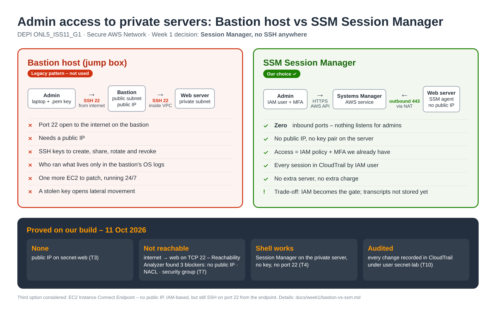

# Bastion host vs SSM Session Manager (Week 1, task 1.6)

**Decision:** admin access to private servers uses **AWS Systems Manager Session Manager**. There is **no bastion host and no SSH** anywhere in the design.

**Why:** Session Manager removes the whole SSH attack surface: no open port 22, no public IP, no SSH keys to share or rotate. Every session is tied to an IAM user and recorded in CloudTrail.

Source: [`bastion-vs-ssm.html`](bastion-vs-ssm.html) (edit and re-render to update).

## Comparison

| | Bastion host (jump box) | **SSM Session Manager (chosen)** | EC2 Instance Connect Endpoint |
|---|---|---|---|
| How you get in | SSH to a public EC2, then SSH on to private hosts | Console or `aws ssm start-session`, over HTTPS (443, outbound from the agent) | SSH through an AWS-managed endpoint inside the VPC |
| Inbound ports open | 22 on the bastion (internet-facing) + 22 from bastion to every host | **None** | 22 from the endpoint only |
| Public IP needed | Yes (the bastion) | **No** | No |
| Credentials | SSH key pairs to create, share, rotate and revoke | IAM users + MFA we already have; access controlled by IAM policy | IAM + short-lived keys |
| Audit trail | Who ran what lives in the bastion's own OS logs (can be altered) | Session start/end per IAM user in CloudTrail; optional full transcript to S3/CloudWatch | CloudTrail |
| Running cost | One EC2 running 24/7 + its public IPv4 | No extra charge (needs NAT or SSM VPC endpoints) | No extra charge |
| Patching | We patch and harden the bastion | AWS-managed agent on the instance | AWS-managed |
| Main risk | Internet-facing SSH: brute force, leaked keys, lateral movement | Over-broad IAM permissions (who may start sessions) | SSH still in use on hosts |
| Fit | Legacy pattern | ✅ Best for this project | Good when a tool truly needs SSH |

## Evidence from our build (2026-10-11)

| What | Result | Evidence |
|---|---|---|
| Web server has no public IP and no key pair | `PublicIpAddress = None`; launched without a key pair | `../evidence/week1/w1-1.3-tf-web-no-public-ip.png`, `w1-1.2-console-ec2-details.png` |
| Shell access without SSH | Session Manager sessions opened on `lab-web` and `secnet-web`; `curl`, `mysql` and port tests run from them | `w1-1.2-console-ssm-curl.png`, `w1-1.4-ssm-db-open.png`, `w1-1.3-tf-drift-*.png` |
| Port 22 unreachable from the internet | Reachability Analyzer IGW → web, TCP 22: **Not reachable**, 3 blockers: no public IP, private NACL, no SG rule | `w1-1.3-reachability-22.png` |
| Least privilege on the role | Instance role has only `AmazonSSMManagedInstanceCore`; it cannot read the DB secret | `w1-1.2-console-iam-role.png` |
| Audit | Every change today is in CloudTrail under `secnet-lab` | `w1-1.4-cloudtrail-events.png` |

## Trade-offs we accept

- **Session Manager depends on outbound HTTPS** from the instance to the SSM service. Today that goes through the NAT gateway; in Week 2 the spokes use SSM **interface endpoints** instead, so they need no internet at all.
- **IAM becomes the gate.** Anyone with `ssm:StartSession` on an instance can get a shell. In production we would limit it by tag (e.g. only `Project=secure-network`) and require MFA.
- **`AmazonSSMManagedInstanceCore` is broad.** It also allows reading Parameter Store values. A production setup would use a custom policy.
- **Session transcripts are not stored yet.** CloudTrail records who started a session, not what was typed. Enabling Session Manager logging to S3/CloudWatch is a candidate for Week 4.

## Optional bastion lab

Not done. The comparison relies on the evidence above. If the team runs the lab (guide 1.6, ~30 min, deleted the same day), add its screenshots here. SSH stays restricted to one `/32` IP and never reaches the private servers.
